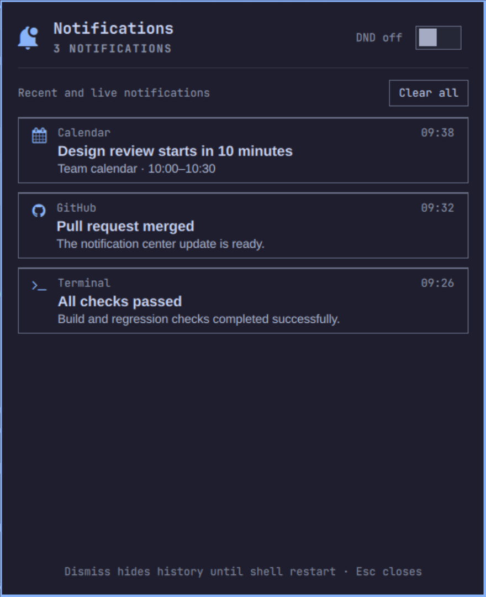

# Omarchy Notification Center

A notification center for Omarchy, maintained in
[rtome85/omarchy-notification-center-plugin](https://github.com/rtome85/omarchy-notification-center-plugin).
Displays live notifications and saved history, with Do Not Disturb controls and a bar badge.
Uses Omarchy's notification daemon and creates no separate notification archive.

This fork builds on [Shavanced's original plugin](https://github.com/Shavanced/omarchy-notification-center-plugin).
The plugin ID remains `shavanced.notification-center` for compatibility with existing installations and bar layouts.

## Preview



Current panel on Omarchy 4.5.0, captured with sample notifications. Colors and fonts follow your active theme.

## Requirements

- Omarchy with Quickshell and its built-in `omarchy.notifications` service.
- The current notification state format: `live.json`, `history.json`, and `quiet.json` under `~/.local/state/omarchy/notifications/`.

Tested locally on Omarchy `4.5.0` (Arch package `4.5.0-3`) on 6 November 2026, verified with `omarchy version`. Older notification implementations using individual history files are not supported by this version.

## Install

```bash
omarchy plugin add https://github.com/rtome85/omarchy-notification-center-plugin.git --enable
```

The widget appears on the right side of the bar. Its ID still uses `shavanced`; the repository and maintainer are `rtome85`.

If this fork is already installed from Git:

```bash
omarchy plugin update shavanced.notification-center
```

If your installed Git checkout still points to the original repository, switch its remote before updating:

```bash
git -C ~/.config/omarchy/plugins/shavanced.notification-center remote set-url origin https://github.com/rtome85/omarchy-notification-center-plugin.git
omarchy plugin update shavanced.notification-center
```

Preserve any local edits before updating. Omarchy refuses an update that cannot fast-forward; a manually copied installation has no Git remote and should be synced from its working copy instead.

To restore an installed widget to the bar:

```bash
omarchy plugin enable shavanced.notification-center --section right
```

## Use

- Left-click the bell to open or close the panel.
- Right-click the bell, or use the panel switch, to toggle Do Not Disturb.
- Click a notification or its dismiss button to dismiss it from the panel.
- **Clear all** dismisses live toasts and hides the panel's current history.
- Press `Esc` or click outside the panel to close it.

Open or close the panel from a keybinding or terminal:

```bash
omarchy-shell shavanced.notification-center toggle
```

Check the loaded counts and DND state without printing notification contents:

```bash
omarchy-shell shavanced.notification-center probe
```

Send a test notification:

```bash
notify-send -a "Test" "Notification Center" "Hello from Omarchy!"
```

The badge counts visible live and historical entries, not unread messages. Opening the panel does not mark history as read or replay it as new toasts.

## How it works and current limits

The plugin reads Omarchy's sanitised notification state files, watches for changes, and refreshes every two seconds as a fallback. It uses shell IPC for DND and live dismissal, without accessing private notification service objects.

- History retention and redaction are controlled by Omarchy.
- Dismissing history hides it in this panel until the shell restarts. It does not erase Omarchy's saved history.
- Omarchy dismisses live toasts by summary substring, so matching toasts can close together.
- Verification messages are redacted in saved state. Hiding one here may leave its original toast visible until it expires.
- Hidden entries are local to each monitor's widget instance and reset on shell restart.

## Development

```bash
git clone https://github.com/rtome85/omarchy-notification-center-plugin.git
cd omarchy-notification-center-plugin
```

Run regression checks, parse the QML, and validate the manifest:

```bash
node scripts/test-current-state.js
qmlformat BarWidget.qml >/dev/null
omarchy plugin validate .
```

Sync the working copy into the installed plugin directory and restart the shell:

```bash
scripts/dev-sync.sh
```

The sync script mirrors the working copy into `~/.config/omarchy/plugins/shavanced.notification-center/`, deleting destination files absent from the source, except `.git`. It supports `--watch` and the `PLUGIN_SRC`/`PLUGIN_DEST` environment variables. Back up any edits made directly in the installed directory before syncing.

A shell restart loads a fresh QML engine; rescanning alone can retain compiled plugin code.

## Security

Omarchy plugins run as unsandboxed code inside the long-lived shell process. Review changes before enabling or updating a plugin. Notification text is rendered as plain text, and this plugin does not execute commands stored in notifications or upload notification data.

## License and attribution

MIT. See [LICENSE](LICENSE). Original project by Shavanced; this fork is maintained by rtome85. Original copyright notices are retained.
